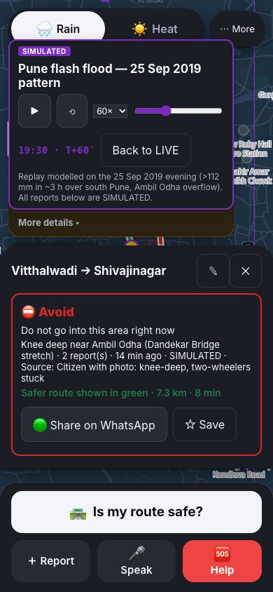

# Sajag · सजग — stay alert in rain and heat

**Team Tokenizers** · Naya Bharat 2047 · Code for Bharat (Rotary × Rotaract Youth Festival, Pune)
**Problem statements:** **7.3** *"Which road is flooded right now?"* (primary) · **7.2** *"Too hot to work, too poor to stop"*

### ▶ Live app: **https://sajag-app.vercel.app**

It works in any phone browser, with no app store needed, and installs to the home screen as an app (⋯ More → **Install Sajag on your phone**).

| Try this (60 seconds) | Link |
|---|---|
| Live Pune map, today | https://sajag-app.vercel.app/?setup=0 |
| Replay of the **25 Sep 2019 Pune flash flood** → tap **Is my route safe?** → demo route | https://sajag-app.vercel.app/?scenario=pune-2019-09-25 |
| Replay of a **hot pre-monsoon afternoon** → **Start work** | https://sajag-app.vercel.app/?scenario=pune-heat-afternoon |
| Dark mode · Marathi | add `&theme=dark` · ⋯ More → मराठी |
| Other cities | `?city=mumbai` · `?city=bengaluru` · `?city=hyderabad` |

<p>



</p>

---

## Contents
1. [The problem](#1-the-problem)
2. [Who we built it for](#2-who-we-built-it-for)
3. [How Sajag solves it](#3-how-sajag-solves-it)
4. [Features](#4-features)
5. [How it works](#5-how-it-works)
6. [Trust, safety and privacy](#6-trust-safety-and-privacy)
7. [Run it, test it](#7-run-it-test-it)
8. [Honest limits](#8-honest-limits)
9. [What we would improve next](#9-what-we-would-improve-next)
10. [How it scales](#10-how-it-scales)
11. [Data, credits and licences](#11-data-credits-and-licences)

---

## 1. The problem

### 7.3 — "Which road is flooded right now?"
During heavy monsoon rain in Pune, Mumbai or Bengaluru, underpasses and low-lying roads can flood **within an hour**. Commuters, two-wheeler riders and school buses drive into waterlogged streets because there is **no reliable, live picture of which roads are safe**. The information that does exist is scattered across WhatsApp forwards and social media posts, and usually arrives too late.

- On **25 Sep 2019**, more than **112 mm** of rain fell on south Pune in about **three hours**. The encroached Ambil Odha stream burst its banks and close to **20 people died** (figures from the official problem statement).
- The risky spots are **already known**:
  - The **Pune Municipal Corporation (PMC)** lists **201** waterlogging-prone locations (Punekar News, 29 Sep 2026).
  - In July 2026, **Pune Traffic Police** mapped **26** locations that are highly prone to waterlogging (Punekar News, 3 Jul 2026).
  - Yet about an hour of heavy rain still waterlogs the city.
- **What is missing is the live layer:** *is this road flooded right now, how deep, and is there a safer way?*

### 7.2 — "Too hot to work, too poor to stop"
Delivery riders, construction workers, vendors and traffic police cannot stay indoors when it is hot. They need to know **how dangerous the heat is where they stand**, **when to rest and drink**, and **what to do if someone collapses**, in their own language.

General weather apps show the air temperature. They do not show heat stress, which also depends on humidity and sun, and they give no work/rest guidance. Maharashtra's heat SOP (13 Apr 2026) prescribes a mandatory 12–4 pm break on orange and red days. That rule only helps if it reaches the worker's phone.

---

## 2. Who we built it for
People who **cannot stay indoors**:
- daily commuters, two-wheeler and delivery riders, auto and bus drivers;
- construction, street and outdoor workers, vendors;
- parents and school transport.

They need **one answer, in their language, in under 10 seconds**:
- *"Is my road flooded?"*
- *"Is it safe to keep working?"*
- *"Where is the nearest water or shade?"*
- *"Someone is unwell — what do I do?"*

---

## 3. How Sajag solves it

| Principle | What it means in the app |
|---|---|
| **One answer first** | Each side (🌧 Rain / ☀️ Heat) opens on one status card: one sentence and one colour, plus a 🔊 button that reads it aloud. Everything else sits behind three big buttons. |
| **Fuse every source, show the evidence** | Citizen reports, official alerts, weather cells, radar and known flood spots feed one engine. Every pin shows **who reported it and how old it is**. |
| **Verdicts, not raw data** | "Is my route safe?" returns **Safe / Caution / Avoid**, the reason, and a **safer route**. A shift returns **Work 30 · Rest 30 · water at 12:50 · safe again 16:00**. |
| **Your language, your voice** | 5 languages (English, मराठी, हिन्दी, ಕನ್ನಡ, తెలుగు). Answers are spoken aloud. Saying *"मदत करा"* ("help") opens emergency numbers straight away. |
| **Report in under 10 seconds** | Picture tiles (water on road / blocked drain; ankle / knee / waist figures), an optional photo, one tap to send, live on every phone. |
| **Honest by design** | Replays are labelled **SIMULATED**, weather is shown as regional cells (never fake street-level precision), and a disclaimer appears on every screen. |
| **Works anywhere** | No app store needed: an installable **PWA** with an offline app shell. It opens zoomed to where you are. |

---

## 4. Features

### 🌧 Rain side (7.3)
- **Live map of waterlogged roads**, built from four sources:
  - **citizen reports:** water on road or blocked drain, depth, underpass, photo;
  - **NDMA SACHET** official alerts;
  - **Open-Meteo** rain cells;
  - **RainViewer** radar.
- **"Is my route safe?"**
  - Real road routing (OSRM) between saved places, a landmark, *My location*, or a point picked on the map.
  - Every report within **300 m** of the route is scored. The verdict is **Safe / Caution / Avoid**, with the evidence, the source and its age.
  - It draws an **automatic safer route** in green. When the router offers no clean alternative, a detour via-point is computed around the hazard.
  - If every route crosses the hazard, it offers the **less risky route with a clear caution**. It never says "safe".
  - The route **re-plans live** when new reports arrive, and can be shared on WhatsApp.
- **Known flood spots, all from 2026 sources:**
  - **Pune 19:** 10 from the Pune Traffic Police list (Jul 2026) + 9 reported in the 2026 monsoon.
  - **Mumbai 13**, **Bengaluru 11**, **Hyderabad 17**.
  - Every popup links the dated article.
- **Reporting in under 10 seconds:**
  - Big picture tiles and an optional photo, compressed on the phone.
  - A **GPS check:** you must be within 300 m of the spot.
  - Live sync to every phone (Supabase Realtime).
  - Reports move **unverified → confirmed → stale → cleared** through "Still there" / "Cleared" votes and automatic expiry (flood reports 2 h, blocked drains 6 h).
- **Paste a police / news post** (⋯ More): paste a Traffic Police or news message. Sajag finds the places and the depth (English, Marathi, Hindi) and pins them, clearly tagged as pasted.
- **👤 My reports:** your active and earlier reports, and how many people they helped (distinct others who confirmed them).

### ☀️ Heat side (7.2)
- **Heat stress at your spot:** an estimate of WBGT (wet-bulb globe temperature, the standard heat-stress measure). It is computed from Open-Meteo wet-bulb temperature and solar radiation, not just air temperature, and drawn as regional cells.
- **Start work: a shift companion.**
  - A work/rest cycle for light, moderate or heavy work, stricter if you are **new to the heat**.
  - It re-checks every **30 minutes** and reminds you to **drink water every 20 minutes**.
  - It tells you **"safe to work again at HH:MM"**.
  - On orange/red days it shows the **Maharashtra heat SOP** (break 12–4 pm; work 6–11 am and 4–8 pm) and the NDMA gig-worker advisory.
  - It keeps the screen awake, speaks reminders aloud, and **sends the status to your crew** in one tap.
- **"I feel unwell":** a quick check of warning signs. Red flags (confusion, fainting, hot dry skin) lead to **Call 108 first**, then first aid. Otherwise it gives rest and ORS advice and points to the nearest clinic or water.
- **💧 Water / shade near me:**
  - **2,395 points in Pune** from OpenStreetMap:
    - **public spots first:** drinking-water taps, parks, bus shelters and stations, public shelters, public toilets;
    - **clinics and pharmacies (ORS)** behind their own filter chip.
  - Every point has 🧭 walking directions.
  - **＋ Add free water spot:** anyone can add a water booth or *pyaau* (public drinking-water stall); these are barely mapped in OpenStreetMap today.

### For everyone
- **5 languages:**
  - the picker shows each language in its own script;
  - it recommends the local language when it knows your location;
  - every screen and alert is translated.
- **🔊 Voice out:** every answer can be read aloud. English uses recorded voice clips; other languages use the phone's voice.
- **🎤 Speak to report:** say *"पुलाखाली गुडघाभर पाणी आहे, स्वारगेट जवळ"* ("knee-deep water under the bridge, near Swargate") and the report fills itself in (**knee-deep · Swargate**). Speech-to-text is Deepgram Nova-3, run on the server so the key never reaches the browser.
- **🆘 Spoken help:** *"मदत करा"* / *"बचाओ"* / *"help"* ("help" / "save me") opens the **emergency sheet** at once (108 ambulance, 112, city helplines). **No login is ever needed for help or for viewing.**
- **Opens where you are:** the first GPS fix zooms the map to you. If you are in another supported city, it offers to switch.
- **Season-aware:** opens on Heat in Feb–May and on Rain in Jun–Oct.
- **Installable PWA:** home-screen icon, "Rain check" and "Heat shift" shortcuts, offline app shell; ⋯ More → *Install Sajag on your phone* (Android install prompt, or the iPhone steps).
- **Dark mode**, **big touch targets**, layouts from 320 px phones to projectors.
- **Scenario player for demos:** replays the 2019 flood and a heat afternoon with **play / scrub / speed** controls. Everything is tagged **SIMULATED**, and the panel can be minimised so the map stays visible.

---

## 5. How it works

```
Phone (PWA: vanilla JS + Vite, MapLibre GL + PMTiles vector map, service worker)
 │
 ├─ Engine (same code for LIVE and REPLAY; every function takes `now`)
 │    pin.js        one Pin contract: flood · clog · hotspot · cooling, each with source + createdAt
 │    store.js      seed + live + scenario pins → status (unverified/confirmed/stale/cleared), "Near <landmark>"
 │    advisory.js   ONE rule table: severity ladder + card text for Rain and Heat
 │    route.js      OSRM alternatives → score pins within 300 m → detour via-point → verdict
 │    heat/         WBGT estimate · work/rest table · safe-again time · illness triage
 │
 ├─ Supabase (Mumbai region)    Google / email login · reports + votes · row-level security
 │                              DB rate limit (5 reports / 30 min) · Realtime
 ├─ Vercel Functions            /api/sachet (NDMA SACHET RSS proxy) · /api/transcribe (Deepgram, server key)
 ├─ OSRM                        public router in production; local Docker container for development
 └─ Open data                   Open-Meteo (rain, wet-bulb, radiation) · RainViewer radar · OpenStreetMap / Protomaps
```

### The severity ladder (Rain)

| Colour | When |
|---|---|
| **Green** | No reports nearby, no heavy rain. |
| **Yellow** | Rain expected, or an unverified report nearby. |
| **Orange** | A confirmed ankle-deep report on or near the route, a blocked drain during heavy rain, or an unconfirmed underpass report. |
| **Red** | Confirmed knee-deep or deeper, a confirmed/official underpass report, a river/nullah/dam alert for the corridor, or an official road-closed post. |

**Rider mode:** confirmed ankle-deep water is already **Red** for a two-wheeler. Sajag **never** advises wading through knee-deep water.

### Built to travel: city packs
Each city is one JSON file in [`citypacks/`](citypacks/). It holds:
- map bounds and tiles;
- the SACHET feed;
- languages and voice languages;
- helplines;
- the flood-spot and cooling-point data files.

Pune, Mumbai, Bengaluru and Hyderabad are live today. Every tunable (radii, expiry, thresholds) is in [`config.js`](config.js), and every advisory rule is in one table, [`src/engine/advisory.js`](src/engine/advisory.js).

### Project layout
```
src/
  engine/   pin contract, advisory rules, routing, gazetteer (EN/MR/HI place matcher), SOS word detection
  heat/     WBGT, work/rest, safe-again, illness triage, shift + unwell screens
  map/      MapLibre layers: pins, weather cells, radar
  ui/       status cards, report sheet, route panel, help, More menu, voice, water/shade chips, top-stack layout
  backend/  Supabase client, auth, reports (the only place that talks to the database)
  feeds/    SACHET, Open-Meteo
  scenario/ replay player + the two scenario scripts
  i18n/     en, mr, hi, kn, te + speech
api/        Vercel Functions (sachet, transcribe)
supabase/   database migrations (tables, row-level security, rate limit)
citypacks/  one JSON per city
```

---

## 6. Trust, safety and privacy
1. **Every pin shows source + age.** A pin without both is never drawn.
2. **LIVE vs SIMULATED:** replay data is always tagged. Fake rain is never drawn as radar tiles.
3. **Regional honesty:** weather is drawn as ~12 km cells, never as street-level precision we do not have.
4. **Underpass rule:** an unconfirmed underpass report is Orange, and a confirmed or official one is Red at any depth.
5. **Login is required to report or vote, never to view or get help.** Reports are checked against your GPS position (within 300 m) and **rate-limited in the database** (5 per 30 minutes).
6. **Row-level security:** anyone can read; signed-in users can only write as themselves; votes confirm or clear reports.
7. **Secrets stay on the server:** the Deepgram key lives only in a Vercel Function. The browser only has the Supabase publishable key. A secrets audit found no secret in the git history or in the live bundle (see [`docs/SECURITY-REVIEW.md`](docs/SECURITY-REVIEW.md)).
8. **A disclaimer on every screen:** *community reports, not an official warning — follow IMD / PMC instructions.*

---

## 7. Run it, test it

```bash
npm install
npm run dev          # http://localhost:5173   (?setup=0 skips first-run setup)
npx vite build       # must stay green
```

Optional `.env.local` (the app runs read-only without it):
```
VITE_SUPABASE_URL=...                  # login + shared reports
VITE_SUPABASE_PUBLISHABLE_KEY=...
DEEPGRAM_API_KEY=...                   # voice; server-side only (no VITE_ prefix)
VITE_OSRM_URL=https://router.project-osrm.org
```

Self-tests:
```bash
node scripts/heat-selftest.mjs       # WBGT, work/rest table, safe-again time, illness triage
node scripts/advisory-selftest.mjs   # severity ladder + advisory rules
node scripts/voice-selftest.mjs      # spoken-help detection (5 languages) + voice-report parsing
```

Deploy: `vercel deploy --prod` (Vercel project `sajag`). Database: `supabase db push --remote --dry-run`, then apply.

---

## 8. Honest limits
- **Heat stress is a regional estimate** from public weather data, not a sensor at your spot. The work/rest table is simplified from ACGIH guidance.
- **Translations:** Kannada and Telugu text, and parts of Marathi and Hindi, were machine-written and need a native-speaker review. Marathi/Hindi voice uses the phone's own text-to-speech, and the quality varies by device.
- **Helplines:** only **112** and **108** are verified. The other city numbers need a call-check.
- **Cold start:** a crowdsourced map is only as good as its reporters. Day-one value comes from the official alerts, weather cells and known flood spots; reports add the live layer.
- **Water booths and *pyaau* stalls** are barely in OpenStreetMap, so they depend on people adding them.
- **Routing in production** uses the public OSRM demo server. It is fine for a prototype, but not for city scale (see §10).
- **Pending:** a prepared database migration that hardens report writes (server-set timestamps, no self-votes, a photo size cap) is written but not yet applied.

---

## 9. What we would improve next

**Reach people where they already are**
- **WhatsApp bot:** reply to anyone posting about waterlogging with a one-tap structured report, and send route alerts on WhatsApp. This is the PetaBencana (Jakarta) pattern, proven at city scale.
- **Push alerts for saved routes:** *"Your 6 pm route has a new Red report at Dandekar Bridge."*
- **SMS / IVR fallback** for feature phones: missed-call → spoken status in Marathi.

**Better data and trust**
- **Photo checks:** on-device blur of faces and number plates, and a "is this water?" check before upload.
- **Reporter reputation:** trusted reporters (Rotaract/NSS volunteers, traffic wardens) confirm faster; repeat bad actors are muted.
- **Official tier:** PMC, Traffic Police and fire brigade accounts post verified pins and "road closed" notices that rank above citizen reports.
- **Sensors when available:** fuse water-level sensors (the IIT Bombay *Mumbai Flood* model), CCTV, and IMD nowcasts into the same engine.
- **Heat:** a recorded native voice for every language; per-ward heat maps; employer dashboards to log breaks.

**Product polish**
- A native-speaker review of all five languages, and verified helplines for every city.
- Offline map tiles for the user's own ward, so the map works with no signal during a storm.
- Accessibility pass: screen-reader labels, larger-text mode, colour-blind-safe status colours.

---

## 10. How it scales

**More cities: new data, no new code**
- A city is one **city-pack JSON** (bounds, tiles, alert feed, languages, helplines) plus two data files (flood spots, cooling points).
- The engine, routing, languages and UI are unchanged.
- The next packs are Maharashtra's **15 high-risk heat districts** from the state heat SOP (Nagpur, Chandrapur, Akola, Jalgaon and others), then other flood-prone metros.

**Infrastructure**

| Today (prototype) | At city / state scale |
|---|---|
| Public OSRM demo server | Self-hosted OSRM (or Valhalla) per state, with live road closures fed in as penalties |
| Map tiles bundled with the app on Vercel | Tiles on a CDN / object storage (Cloudflare R2), one file per city |
| Supabase free tier | Supabase Pro / Postgres with read replicas; Realtime channels per city; PostGIS queries by viewport |
| Open-Meteo regional cells | IMD nowcasts + ward-level grids; a city-run sensor feed if one exists |
| Deepgram for speech | The same API, or an on-device model for offline Marathi/Hindi |

The app is a static PWA plus a database, so most load sits on the CDN. Writes are small (a pin and a photo), and rate limits are enforced in the database.

**Institutional home**
The closest global precedent, RiskMap/PetaBencana, worked because government agencies validated the reports. Its weakest point is having no long-term owner. Our plan:
- **Reporters:** Rotaract, NSS and college volunteers as trained first reporters each monsoon.
- **Authority loop:**
  - confirmed reports become a **ward-wise work list** for PMC (location, photo, time, cause);
  - cleared reports build up a **flood-prone-spot history** the city can use for drain repairs.
- **Open data:** an open API and open-source code, so the city, researchers and other apps can use the live layer. Delivery apps and cab platforms could embed the live layer for their riders, as PetaBencana did with Uber in Jakarta.
- **Heat SOP delivery:** the state wrote the policy, and Sajag puts it in a rider's pocket, in Marathi.

---

## 11. Data, credits and licences
- **Map:** © OpenStreetMap contributors, tiles by Protomaps.
- **Routing:** OSRM.
- **Official alerts:** NDMA SACHET.
- **Weather:** Open-Meteo.
- **Radar:** RainViewer.
- **Speech-to-text:** Deepgram.
- **Flood-spot sources** (each spot's popup links its exact article):
  - **Pune:** Pune Traffic Police via Punekar News / Pune Pulse; The Bridge Chronicle.
  - **Mumbai:** BMC via Free Press Journal, The Week, Mumbai TV.
  - **Bengaluru:** Deccan Herald, News Karnataka, Bengaluru South City Corporation.
  - **Hyderabad:** Hyderabad Traffic Police; Telangana Today, Hyderabad Mail and others.
- **Cooling points:** OpenStreetMap: hospitals, clinics, pharmacies, parks, bus shelters and stations, shelters, toilets, drinking water.
- **Policy:** Maharashtra heat SOPs (13 Apr 2026), NDMA heat-wave guidelines.

Spec: [`docs/PRD.md`](docs/PRD.md) · Build log: [`docs/HANDOFF.md`](docs/HANDOFF.md) · Contributor guide: [`AGENTS.md`](AGENTS.md) · Security: [`docs/SECURITY-REVIEW.md`](docs/SECURITY-REVIEW.md)
