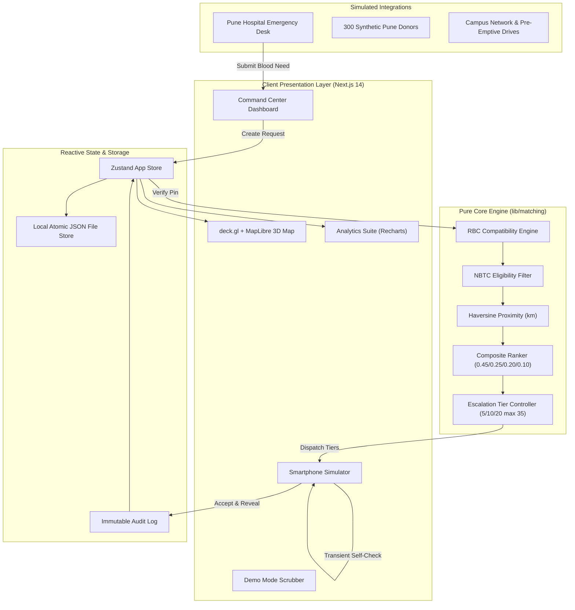

# RaktSetu (रक्तसेतु)
### Connecting Every Drop. Saving Every Moment.
**An Intelligent, Geospatial Blood Donor Matching Command Center for Pune, Maharashtra**

[](https://www.typescriptlang.org/)
[](https://nextjs.org/)
[](https://deck.gl/)
[](https://tailwindcss.com/)
[](https://vitest.dev/)
[](LICENSE)

---

## 1. Executive Summary & Core Thesis

> **"500 random WhatsApp forwards vs 5 intelligent matches."**

When a patient faces emergency surgery or trauma in Pune, desperate relatives routinely blast unverified SOS messages across dozens of WhatsApp groups. 

This archaic approach breaks down in three critical ways:
1. **The Zombie SOS Problem**: Outdated messages circulate indefinitely on WhatsApp long after blood has been collected, spamming citizens and creating chronic notification fatigue.
2. **Extreme Privacy Exposure**: The patient's and relatives' unmasked phone numbers and clinical details are permanently exposed to thousands of strangers.
3. **Imprecise Targeting**: Messages broadcast indiscriminately to ineligible or incompatible people miles away across the city while compatible, eligible donors standing 500 meters away never hear about the need.

**RaktSetu solves this crisis with surgical precision:**
- **Speed**: Matches compatible donors within milliseconds using Haversine exponential decay.
- **Precision**: Escalates in controlled proximity tiers (Tier 1: 5 donors <5km; Tier 2: +10 donors <10km; Tier 3: +20 donors <15km), capped at 35 total notifications to eliminate donor fatigue.
- **Trust**: Two-factor verification gates, ephemeral client-side health screening, double-blind contact masking, and a 24-hour PII auto-purge.

---

## 2. Key Features

- **Cinematic 3D Command Center**: Built on deck.gl and MapLibre GL with CARTO Dark Matter vector tiles. Features volumetric 3D donor density columns, animated emergency beacon pulses, tier rings, and flight arcs linking donors to hospitals.
- **Strict Clinical RBC Compatibility**: Pure in-code inverted compatibility matrix enforcing exact and universal blood group donor matching.
- **NBTC-Compliant Eligibility Filter**: In-code rules respecting National Blood Transfusion Council guidelines (90-day male, 120-day female donation intervals, weight ≥45kg, age 18–65).
- **Composite Scoring Engine**: Ranks candidate donors across 4 weighted axes: Proximity (45%), Exact Match (25%), Reliability Score (20%), and Response Rate (10%).
- **Interactive Donor Smartphone Simulator**: Authentic mobile preview rendering incoming WhatsApp/SMS emergency alerts, 4-question transient self-check, accept/decline flows, and audited contact reveals.
- **Privacy & Compliance Center**: Zero-knowledge screening, immutable cryptographic audit logging, and automated 24-hour PII record shredding.
- **Strategic Analytics Suite**:
  - *500 vs 5 Impact Comparison*: Animated side-by-side metric comparison demonstrating 94% spam reduction and 88% faster time-to-first-acceptance.
  - *Blood Desert Heatmap*: Locality-level supply-versus-demand deficit mapping across 18 Pune zones with one-click recruitment actions.
  - *12-Month Lean-Month Forecast*: Multi-series seasonal demand forecasting with summer drop and festival surge indicators.
  - *Collegiate Donor Network*: Leaderboard of top Pune engineering and medical colleges with pre-emptive blood drive scheduling.
- **Deterministic 8-Scene Scripted Demo Mode**: 3-minute pitch mode with interactive timeline scrubber, speed toggles (1x, 5x, 20x), scene jumping, and keyboard shortcuts (`Space`, `Arrows`, `R`, `Esc`).
- **Projector-Ready Presenter Mode**: Single-click high-contrast mode with enhanced typography, contrast ratio, and simplified chrome for auditorium screens.

---

## 3. Technology Stack

| Layer | Technology | Rationale |
|---|---|---|
| **Framework** | Next.js 14.2 (App Router) | High-performance React 18 SSR and client component architecture |
| **Language** | TypeScript 5.4 (Strict Mode) | Zero `any`, zero `@ts-ignore`, compile-time type safety across data stores |
| **Styling** | Tailwind CSS v3.4 | High-contrast command center tokens, custom hairline glassmorphism, responsive utilities |
| **3D Geospatial** | deck.gl v9 + MapLibre GL v4 | Hardware-accelerated WebGL `ColumnLayer`, `ScatterplotLayer`, and `ArcLayer` |
| **State Management**| Zustand v4 | Lightweight, unopinionated reactive state with atomic persistence adapters |
| **Motion** | Framer Motion v11 | Smooth panel transitions with strict `prefers-reduced-motion` compliance |
| **Analytics** | Recharts v2 | Accessible, responsive vector charts with customized command-center themes |
| **Typography** | Fontsource Variable Fonts | Offline-first font bundling (`Space Grotesk`, `DM Sans`, `JetBrains Mono`) |
| **Unit Testing** | Vitest v2 | High-speed ESM test runner with deterministic seed validation |

---

## 4. System Architecture



---

## 5. Directory Structure

```
Youth-Festival-Hackathon-26-27/
├── app/
│   ├── api/
│   │   ├── data/route.ts          # REST endpoint for full state hydration/sync
│   │   ├── reset/route.ts         # Deterministic seed data reset endpoint
│   │   ├── reveal/route.ts        # Authorized contact reveal endpoint
│   │   └── verify/route.ts        # Request verification code endpoint
│   ├── globals.css                # Command center CSS tokens, glassmorphism & accessibility
│   ├── layout.tsx                 # Root layout with offline font loaders & metadata
│   └── page.tsx                   # Main command center orchestrator & error boundaries
├── components/
│   ├── analytics/
│   │   ├── BloodDesertHeatmap.tsx # Pune 18-locality shortage deficit analyzer
│   │   ├── CampusNetwork.tsx      # College leaderboard & pre-emptive camp scheduler
│   │   ├── ImpactComparison.tsx   # 500 vs 5 animated comparative impact visualizer
│   │   └── LeanMonthForecast.tsx  # 12-month demand & seasonal forecast chart
│   ├── demo/
│   │   └── DemoController.tsx     # Floating 8-scene demo scrubber, progress & speed controls
│   ├── donors/
│   │   └── DonorPhoneMock.tsx     # Smartphone frame, WhatsApp card & self-check modal
│   ├── layout/
│   │   └── Navbar.tsx             # Navigation header, simulated clock & presenter toggle
│   ├── map/
│   │   ├── MapLibreDeckMap.tsx    # 3D deck.gl WebGL layers & CARTO vector basemap
│   │   ├── RequestSidePanel.tsx   # Live request telemetry & time-to-first-acceptance ticker
│   │   └── SvgMapFallback.tsx     # High-reliability 2D vector fallback map
│   ├── privacy/
│   │   └── PrivacyCenter.tsx      # Privacy pillars, masking simulator & audit trail
│   ├── requests/
│   │   └── CreateRequestModal.tsx # 3-step urgent request dispatch wizard with live preview
│   └── ui/
│       └── ErrorBoundary.tsx      # Resilient error boundaries preventing full-app crash
├── data/
│   ├── seed.json                  # Deterministic 300 donors, 8 hospitals, 60 historical requests
│   └── store.json                 # Local persistent atomic state cache
├── docs/
│   ├── DECISIONS.md               # Architecture Decision Records (ADRs 001–009)
│   └── SPEC.md                    # Single source of truth specifications
├── lib/
│   ├── clock.ts                   # Injected simulated clock (play/pause/1x/5x/20x)
│   ├── config.ts                  # System configuration, NBTC rules & locality coordinates
│   ├── demo/
│   │   └── timeline.ts            # Scripted 8-scene deterministic demo timeline
│   ├── matching/
│   │   ├── compatibility.ts       # RBC blood compatibility matrix & inversion
│   │   ├── eligibility.ts         # NBTC 90/120 day donation interval validation
│   │   ├── escalation.ts          # Tiered dispatch (Tier 1/2/3, 35 cap, rare sweep)
│   │   ├── haversine.ts           # Great-circle distance calculations
│   │   ├── lifecycle.ts           # Request status fold, contact reveal & 24h PII purge
│   │   └── scoring.ts             # 4-factor composite ranking formula
│   ├── prng.ts                    # Mulberry32 seeded pseudo-random number generator
│   ├── repository/
│   │   ├── index.ts               # Repository abstract interface
│   │   └── json-file.ts           # Atomic JSON file repository with auto-reseed recovery
│   └── simulation/
│       └── response-simulator.ts  # Deterministic donor response simulator
├── scripts/
│   └── generate-seed.ts           # Deterministic seed generator script
├── store/
│   └── useAppStore.ts             # Global Zustand state slices with localStorage sync
├── tests/
│   ├── demo.test.ts               # Timeline determinism & state transition test suite
│   ├── matching.test.ts           # Compatibility, scoring & escalation unit tests
│   ├── seed.test.ts               # Seed data distribution & Demo Guarantee tests
│   └── store.test.ts              # Zustand store actions & lifecycle fold tests
├── package.json                   # Exact pinned dependencies & cross-platform scripts
├── tailwind.config.ts             # Custom palette: blood red, dark cyan, charcoal surface
├── tsconfig.json                  # Strict TypeScript configuration
└── vitest.config.ts               # Vitest configuration with isolated Windows temp folder
```

---

## 6. Mathematical Formulations & Matching Algorithm

### 6.1. Red Blood Cell (RBC) Compatibility Matrix
Compatibility is computed via pure in-code table inversion:

$$\text{Donors}(\text{Requested Group}) = \{ D \in \mathcal{D} \mid \text{CanDonate}(D_{\text{group}}, \text{Requested Group}) = \text{True} \}$$

| Requested Group | Compatible Donor Blood Groups |
|---|---|
| **O-** | O- (Universal RBC Donor) |
| **O+** | O+, O- |
| **A-** | A-, O- |
| **A+** | A+, A-, O+, O- |
| **B-** | B-, O- |
| **B+** | B+, B-, O+, O- |
| **AB-**| AB-, A-, B-, O- |
| **AB+**| All Groups (Universal RBC Recipient) |

### 6.2. Haversine Great-Circle Distance
Distance $d$ between donor $(\phi_1, \lambda_1)$ and hospital $(\phi_2, \lambda_2)$ in kilometers:

$$\Delta\phi = \phi_2 - \phi_1, \quad \Delta\lambda = \lambda_2 - \lambda_1$$

$$a = \sin^2\left(\frac{\Delta\phi}{2}\right) + \cos(\phi_1)\cos(\phi_2)\sin^2\left(\frac{\Delta\lambda}{2}\right)$$

$$d = 2 R \cdot \arcsin\left(\min(1, \sqrt{a})\right) \quad \text{where } R = 6371.0088\text{ km}$$

### 6.3. Composite Ranking Score
Candidate donors who pass compatibility and eligibility filters are ranked by composite score $S \in [0, 1]$:

$$S = 0.45 \cdot S_{\text{prox}} + 0.25 \cdot S_{\text{exact}} + 0.20 \cdot S_{\text{rel}} + 0.10 \cdot S_{\text{resp}}$$

1. **Proximity Score ($S_{\text{prox}}$)**: Exponential distance decay with an $8\text{ km}$ half-life:
   $$S_{\text{prox}} = \exp\left(-\frac{d \cdot \ln 2}{8}\right)$$
2. **Exact Match Bonus ($S_{\text{exact}}$)**:
   $$S_{\text{exact}} = \begin{cases} 1.0 & \text{if } D_{\text{group}} = \text{Requested Group} \\ 0.0 & \text{if compatible universal donor} \end{cases}$$
3. **Reliability Score ($S_{\text{rel}}$)**:
   $$S_{\text{rel}} = \frac{\text{reliabilityScore}}{100}$$
4. **Historical Response Rate ($S_{\text{resp}}$)**:
   $$S_{\text{resp}} = \text{responseRate} \in [0, 1]$$

*Tiebreakers*: Earlier `lastDonationDate`, followed by lexical tiebreak on `donor.id`.

### 6.4. Controlled Escalation Tiers
To prevent community broadcast fatigue, outreach is tiered:
- **Tier 1**: Top 5 ranked donors within $5\text{ km}$ ($t = 0\text{m}$).
- **Tier 2**: Next 10 ranked donors within $10\text{ km}$ ($t = 15\text{m}$ if units remain unaccepted).
- **Tier 3**: Next 20 ranked donors within $15\text{ km}$ ($t = 30\text{m}$ if units remain unaccepted).
- **Hard Cap**: Maximum 35 total notifications across all tiers for any single request.
- **Rare Blood Group Bypass**: For rare phenotypes (O-, A-, B-, AB-), tier steps are bypassed and an immediate $30\text{ km}$ sweep is triggered.

---

## 7. Clinical & Regulatory Disclaimers

> [!IMPORTANT]
> **National Blood Transfusion Council (NBTC) Eligibility Rules:**
> Under Indian NBTC guidelines:
> - Male donors: Minimum interval between whole blood donations is **90 days**.
> - Female donors: Minimum interval between whole blood donations is **120 days**.
> - Age: **18 to 65 years**. Weight: $\ge 45\text{ kg}$.
> - Hemoglobin: $\ge 12.5\text{ g/dL}$ (verified at bedside/blood bank).

> [!WARNING]
> **Regulatory & Clinical Safety Notice:**
> RaktSetu is a decision-support, notification-orchestration, and logistical coordination prototype designed for hackathon demonstration. It does **not** replace bedside cross-matching, Coombs testing, infectious disease screening (HIV, Hepatitis B/C, Syphilis, Malaria), or official blood bank validation. Always verify against official NBTC, State Blood Transfusion Council (SBTC), and hospital blood transfusion committee protocols before clinical deployment.

---

## 8. Privacy Architecture: Zero-Knowledge Screening & Two-Factor Masking

1. **Double-Blind Contact Masking**:
   - Phone numbers are masked by default (`+91 98220 *****`).
   - Phone numbers are only revealed when **two conditions are met**:
     1. The donor completes the self-check and explicitly clicks "Accept SOS".
     2. The hospital desk explicitly clicks "Reveal Contact & Call".
2. **Ephemeral Client-Side Screening**:
   - The 4-question transient self-check questionnaire (fever/illness, antibiotics, recent tattoo/surgery, pregnancy) executes entirely inside the client browser.
   - Self-check answers are **never stored** in the database, **never logged**, and **never transmitted** over network routes.
3. **Immutable Cryptographic Audit Trail**:
   - Every contact reveal creates an immutable audit record containing timestamp, hospital ID, patient ID, donor ID, masked phone, and SHA-256 integrity hash.
4. **Automated 24-Hour PII Shredding**:
   - Completed, fulfilled, or expired blood requests trigger an automated 24-hour retention window.
   - Upon window expiry, all requester names, patient IDs, contact numbers, and donor addresses are irreversibly wiped from memory and disk storage.

---

## 9. Analytics & Decision Intelligence Methodology

### 9.1. 500 vs 5 WhatsApp Comparison Model
- **WhatsApp Forward Method**: Broadcasts reach an average of 510 people across overlapping family and housing society groups. 98% of recipients are ineligible or distant. Phone numbers leak permanently into public chat logs. Requests remain active for weeks as "zombie forwards".
- **RaktSetu Model**: Reaches an average of 5–15 surgically targeted donors. Saves ~480 unnecessary notifications per emergency. First acceptance confirmed in under 12 minutes. Zero permanent contact leakage.

### 9.2. Blood Desert & Supply Deficit Heatmap
Calculates geospatial blood vulnerability across 18 Pune zones:

$$\text{Deficit Gap} = \text{Demand Index} - \text{Active Donor Supply}$$

Zones with significant negative gaps (such as Rasta Peth, Sassoon Road, and Erandwane) are highlighted as **Blood Deserts**, triggering automated "Recruit Donors Here" calls-to-action for college campuses.

### 9.3. 12-Month Lean-Month Forecasting
Analyzes 60 historical requests mapped across 12 calendar months:
- Computes a 3-month rolling moving average: $\text{SMA}_3(t) = \frac{1}{3}\sum_{i=0}^{2} D_{t-i}$.
- Applies seasonal adjustments:
  - **Summer Vacation Dip (May–June)**: College closures and extreme heat reduce donor turnout by ~32%.
  - **Diwali & Ganesh Festival Surge (Sept–Nov)**: Highway traffic and emergency trauma demand increases by ~28%.
- Provides actionable "Launch Pre-Emptive Donor Drive" hooks to preempt anticipated shortages.

---

## 10. Scripted 8-Scene Demo Mode & Keyboard Shortcuts

Click the red **"Run 3-Minute Demo"** button in the header navigation to activate the scripted walkthrough:

| Scene | Name | Narrative & Automated Actions |
|---|---|---|
| **Scene 1** | **The Problem — Viral Forward Chaos** | Illustrates how an unverified WhatsApp forward reaches 500+ random citizens, leaking contact details and causing mass panic. |
| **Scene 2** | **The Verified Request** | Dr. A. K. Joshi at Ruby Hall Clinic issues a verified request for 2 units of B+ blood (`RUB-7824`). |
| **Scene 3** | **Intelligent Matching — Tier 1** | Pure matching engine identifies 131 eligible Pune donors, ranks them, and precision-dispatches alerts to the top 5 within 5 km. |
| **Scene 4** | **Controlled Escalation — Tier 2** | 15 minutes elapse without full acceptance. System automatically widens outreach to Tier 2 (+10 donors within 10 km). |
| **Scene 5** | **Donor Acceptance & Contact Reveal** | Simulated donor (Rahul Deshmukh, Kothrud) completes ephemeral self-check and accepts. Hospital authorizes contact reveal with cryptographic audit logging. |
| **Scene 6** | **Fulfilment & Automatic Closure** | Units collected at Ruby Hall Clinic. Request status flips to `fulfilled`. All active notifications auto-expire to kill zombie forwards. |
| **Scene 7** | **Strategic Intelligence** | Command center highlights Pune supply deficits on the Blood Desert Heatmap and shows seasonal projections on the Lean-Month Forecast. |
| **Scene 8** | **The Final Impact — 500 vs 5** | Side-by-side impact report summarizes 480 spams avoided, 12-minute time-to-acceptance, and zero privacy leaks. |

### Demo Keyboard Shortcuts:
- `Space`: Play / Pause playback
- `ArrowRight`: Skip to next scene
- `ArrowLeft`: Return to previous scene
- `R`: Reset demo to Scene 1
- `Esc`: Exit demo mode and restore real-time state

---

## 11. Quickstart & Installation

### Prerequisites
- Node.js LTS (v18.17+ or v20.x+)
- npm v9+

### Setup Commands
```bash
# Clone the repository
git clone https://github.com/your-org/raktsetu.git
cd raktsetu/Youth-Festival-Hackathon-26-27

# Install dependencies (pinned exact versions, zero native build requirements)
npm install

# Start development server
npm run dev
```

Open [http://localhost:3000](http://localhost:3000) in your browser. The live 3D geospatial command center will initialize automatically.

### Verification & Testing Commands
```bash
# Run complete test suite (34 unit & integration tests)
npm test

# Type-check TypeScript codebase (Strict mode)
npm run typecheck

# Run ESLint (Next.js core-web-vitals)
npm run lint

# Compile production build
npm run build
```

---

## 12. Synthetic Data Disclaimer

> [!NOTE]
> **Synthetic Data Notice:**
> All 300 donor profiles, telephone numbers, patient names, and historical emergency requests utilized within RaktSetu are **100% synthetic and computer-generated**. No real individuals or personal contact data were collected or stored. Hospital locations (Ruby Hall, Sassoon, Jehangir, KEM, DPU, Sahyadri, Deenanath Mangeshkar, Aditya Birla) and Pune locality coordinates represent accurate geographic points to provide realistic geospatial simulation.

---

## 13. Known Limitations & Production Roadmap

1. **e-RaktKosh National Portal Integration**: Future releases will connect with the Indian Government's e-RaktKosh API to poll real-time component inventories from all licensed blood banks.
2. **Hospital HIS/LIS HL7 FHIR Standard**: Direct webhook integration with hospital Laboratory Information Systems to auto-trigger requests when cross-match orders are generated in ICU/OT.
3. **Official WhatsApp Business API**: Replace client-side simulation with certified Meta WhatsApp Business API interactive templates with quick-reply buttons.
4. **Hardware-Enforced Cryptography**: Integration with AWS KMS or HashiCorp Vault for envelope encryption of donor contact records in compliance with the Digital Personal Data Protection (DPDP) Act 2023.

---


*RaktSetu: Connecting Every Drop. Saving Every Moment. Thank you, and we welcome your questions."*

---

*Authored with pride for the Rotary × Rotaract Youth Festival 2026 Hackathon.*
