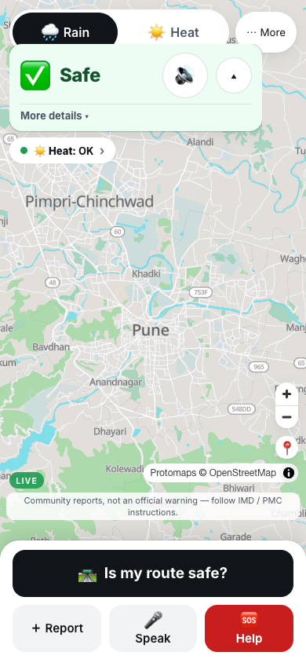
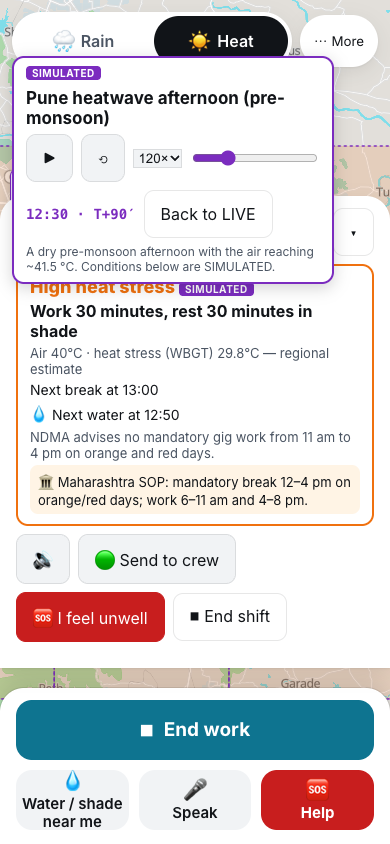

# Sajag · सजग — stay alert in rain and heat

**Team Tokenizers** · Naya Bharat 2047 · Code for Bharat (Rotary × Rotaract Youth Festival, Pune)
**Problem statements:** **7.3** *"Which road is flooded right now?"* (primary) + **7.2** *"Too hot to work, too poor to stop"*

### ▶ Live app: **https://sajag-inky.vercel.app** — works on any phone, installs as an app (PWA)

| Try this (60 s) | Link |
|---|---|
| Live Pune map, today | https://sajag-inky.vercel.app/?setup=0 |
| Replay of the 25 Sep 2019 Pune flash flood → tap **Is my route safe?** → demo route | https://sajag-inky.vercel.app/?scenario=pune-2019-09-25 |
| Replay of a 41 °C afternoon → **Start work shift** | https://sajag-inky.vercel.app/?scenario=pune-heat-afternoon |
| Dark mode / Marathi | add `&theme=dark` · ⋯ More → मराठी |
| Other cities | `?city=mumbai` · `?city=bengaluru` · `?city=hyderabad` |

<p>



</p>

---

## Who it is for

People who **cannot stay indoors**: commuters, two-wheeler and delivery riders, construction and street workers. They need **one answer, in their language, in under 10 seconds**: *Is my road flooded? Is it safe to keep working?*

## What it does

**🌧 Rain (7.3)**
- **Live map of waterlogged roads**: citizen reports (photo, depth, underpass) + **NDMA SACHET** official alerts + **Open-Meteo** rain cells + **RainViewer** radar.
- **"Is my route safe?"**: real road routing (OSRM). Every report within 300 m is scored. The verdict is **Safe / Caution / Avoid**, with the evidence, the source and its age, plus an **automatic safer route** (a detour via-point when the router offers no alternative). The route re-plans live when new reports arrive. Share it on WhatsApp.
- **Known waterlogging spots, all from 2026 sources**:
  - **Pune 19:** 10 from the Pune Traffic Police list (Jul 2026) + 9 reported in the 2026 monsoon.
  - **Mumbai 13**, **Bengaluru 11**, **Hyderabad 17**.
  - Every spot links to its dated source.
- **Report in < 10 s**: picture tiles (ankle / knee / waist figures), photo proof, a GPS check (you must be within 300 m), a database rate limit, and live sync to every phone (Supabase Realtime). Reports go **unverified → confirmed → stale → cleared** through votes and expiry.

**☀️ Heat (7.2)**
- **Heat stress at your spot**: an estimate of WBGT, the heat-stress index that accounts for humidity and sun. Built from Open-Meteo wet-bulb temperature and solar radiation, not just air temperature.
- **Work-shift companion**:
  - a work/rest cycle for light, moderate or heavy work (stricter if you are new to heat)
  - re-checks every 30 min
  - a **water reminder every 20 min**
  - **"safe to work again at HH:MM"**
  - **Maharashtra heat SOP** + NDMA advisory lines on orange/red days
  - the screen stays awake; one tap sends the status to your crew
- **"I feel unwell"**: checks warning signs → **Call 108 first** for red flags, then first aid.
- **Water & shade near me**: **2,395 cooling points**, with walking directions:
  - drinking water and public toilets
  - bus shelters and bus stations
  - parks
  - clinics and pharmacies (ORS)

**For everyone**
- **5 languages** (English, मराठी, हिन्दी, ಕನ್ನಡ, తెలుగు) and **voice**: 🔊 reads every answer aloud.
- **🎤 Speak**: say *"पुलाखाली गुडघाभर पाणी आहे, स्वारगेट जवळ"* ("knee-deep water under the bridge, near Swargate") and the report fills itself in: knee-deep, Swargate. Say *"मदत करा"* ("help!") / *"बचाओ"* ("save me") / *"help"* and the **emergency sheet opens immediately** (108 / 112), no login needed. Transcription is Deepgram Nova-3, server-side, so the key never reaches the browser.
- **Big targets, one answer per screen, dark mode**, works from 320 px phones to projectors.
- **Season-aware**: opens on Heat in Feb–May and on Rain in Jun–Oct.

## Trust rules (enforced in code)
1. Every pin shows **source + age**. A pin without both is never drawn.
2. **LIVE vs SIMULATED**: replays are visibly tagged **SIMULATED**. Fake rain is never drawn as radar.
3. Weather is drawn as **regional cells (~12 km)**, never as street-level precision we don't have.
4. Underpass reports escalate faster, and the app **never advises wading through knee-deep water**.
5. A **disclaimer** is on every screen: *community reports, not an official warning — follow IMD / PMC.*

## Architecture

```
Phone (PWA, vanilla JS + Vite, MapLibre + PMTiles vector map, offline app shell)
 ├─ Supabase (Mumbai region): Google / email login, reports + votes, RLS, DB rate limit, Realtime
 ├─ Vercel Functions: /api/sachet (NDMA SACHET RSS proxy) · /api/transcribe (Deepgram, server-side key)
 ├─ OSRM routing (public router; local Docker for dev)
 └─ Open-Meteo (rain, wet-bulb, radiation) · RainViewer radar · OpenStreetMap / Protomaps
```

- **One engine for live and replay.** Every engine function takes `now`, so the Scenario player swaps only the inputs and the clock.
- **Tunables** are in [`config.js`](config.js). **Advisory rules** are one table: [`src/engine/advisory.js`](src/engine/advisory.js).

## Tests
```
node scripts/heat-selftest.mjs       # WBGT, work/rest table, safe-again time, illness triage
node scripts/advisory-selftest.mjs   # severity ladder + advisory rules
node scripts/voice-selftest.mjs      # spoken-help detection (5 languages) + voice report parsing, incl. real Deepgram output
npx vite build
```

## Run locally
```
npm install
npm run dev        # http://localhost:5173   (?setup=0 skips first-run setup)
```
Optional `.env.local`:
- `VITE_SUPABASE_URL`, `VITE_SUPABASE_PUBLISHABLE_KEY` (login + shared reports; without them the app runs read-only)
- `DEEPGRAM_API_KEY` (voice; server-side only)
- `VITE_OSRM_URL=https://router.project-osrm.org`

## Honest limits
- The heat number is a **regional estimate** from public weather data, not a sensor at your spot. The work/rest table is simplified from ACGIH guidance.
- **Machine-translated text:** Kannada and Telugu, and parts of Marathi and Hindi, need a native-speaker review.
- **Helplines:** only 112 and 108 have been verified.
- **Missing water stations:** government water stations are barely mapped in OpenStreetMap. Crowd-adding them is built in.

## Data & credits
- **Map:** © OpenStreetMap contributors, tiles by Protomaps.
- **Routing:** OSRM.
- **Alerts:** NDMA SACHET.
- **Weather:** Open-Meteo.
- **Radar:** RainViewer.
- **Speech to text:** Deepgram.
- **Flood-spot sources:**
  - **Pune:** Pune Traffic Police via Punekar News / Pune Pulse; The Bridge Chronicle.
  - **Mumbai:** BMC via Free Press Journal, The Week, Mumbai TV.
  - **Bengaluru:** Deccan Herald, News Karnataka, Bengaluru South City Corporation.
  - **Hyderabad:** Hyderabad Traffic Police; Telangana Today, Hyderabad Mail and others.

  Each spot's popup links its exact article.

Spec: [`docs/PRD.md`](docs/PRD.md) · Build log / status: [`docs/HANDOFF.md`](docs/HANDOFF.md) · Contributor guide: [`AGENTS.md`](AGENTS.md)
