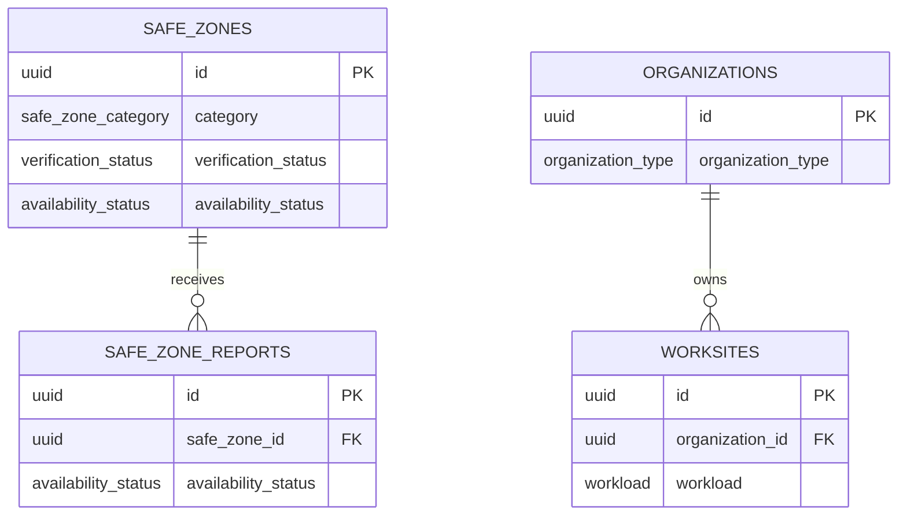

# SunShield database relationships

Every relationship is one-to-many and each child has one required parent. Deleting a SafeZone cascades to its reports. Organizations with worksites cannot be deleted (`RESTRICT`). Both foreign keys cascade parent key updates. No worker account or weather history relationship is stored.
